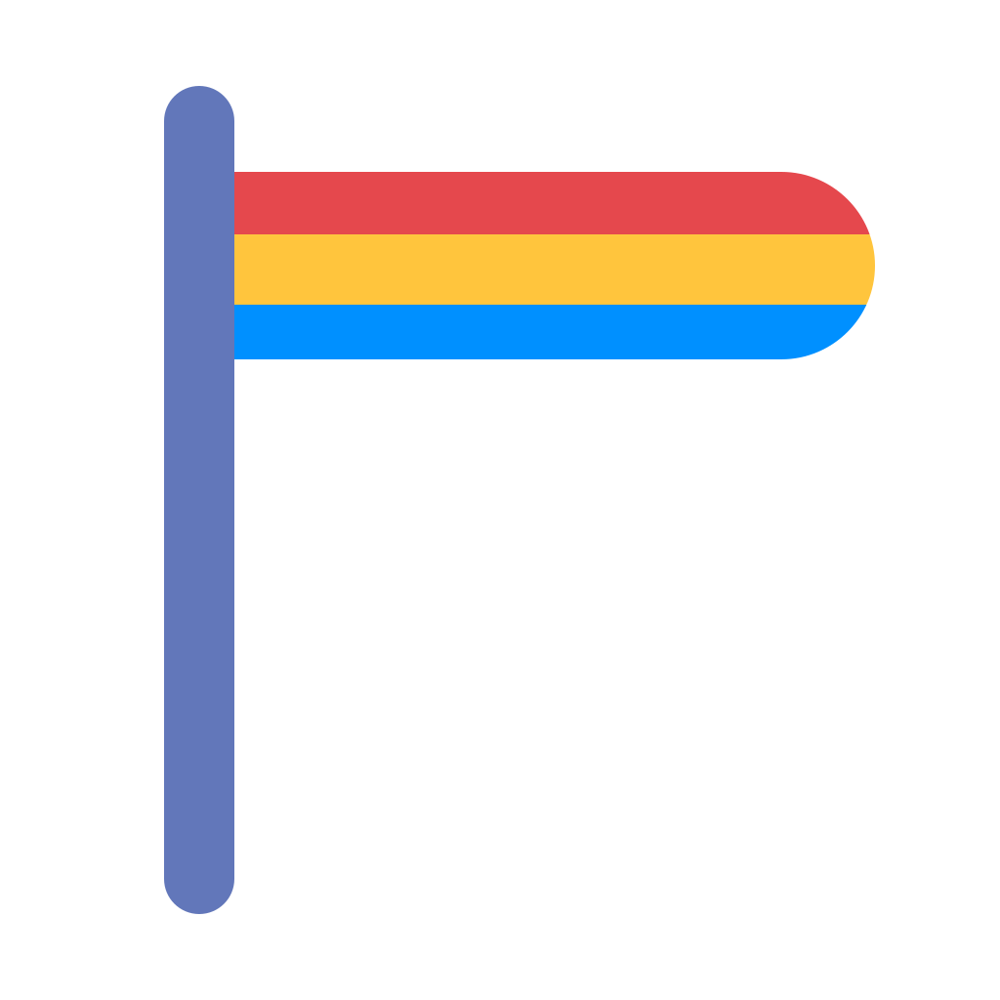
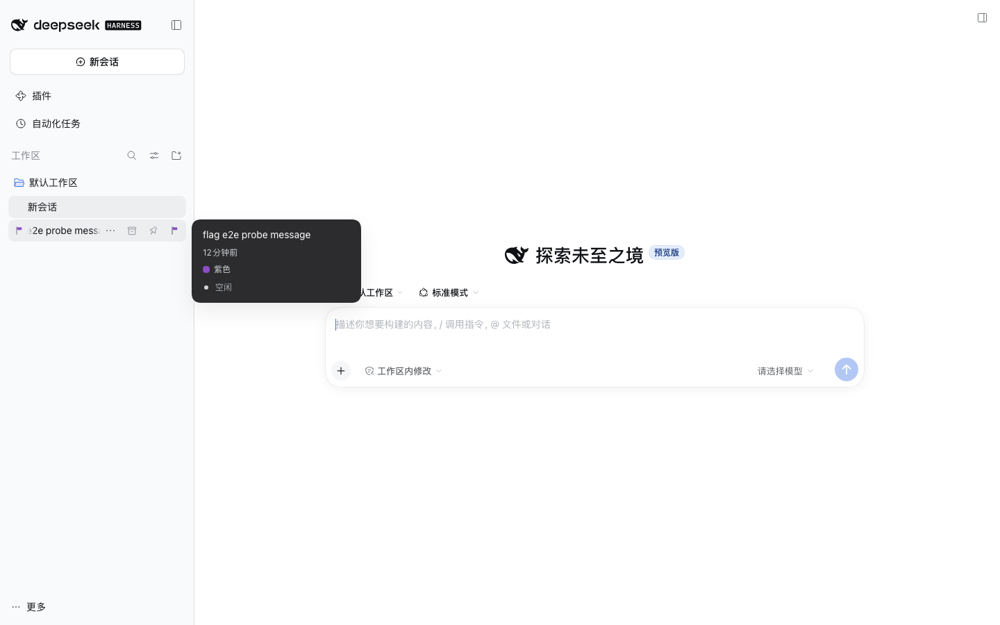
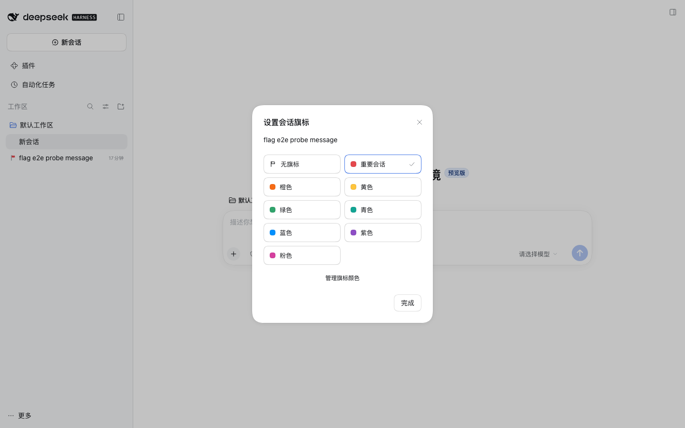
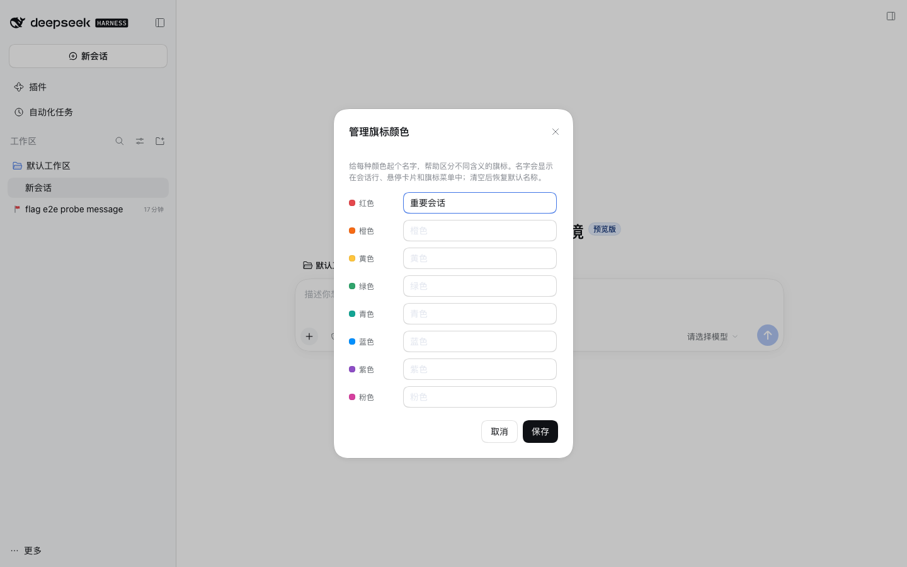
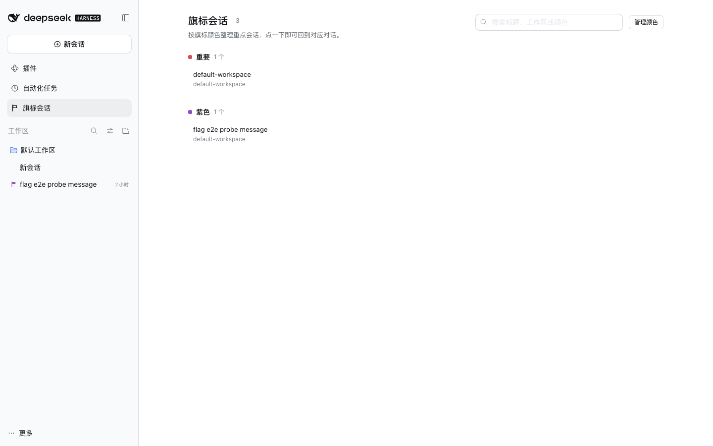

# dsh-session-flags

<p align="center">
  
</p>

<p align="center">
  <b>为 DeepSeek Harness 的会话列表提供可命名颜色的彩色旗标。</b><br />
  标出重要会话，给每种颜色起自己的名字，并在侧边栏的可搜索面板里随时找回它们。
</p>

<p align="center">
  <a href="README.md">English</a> | 中文
</p>

<p align="center">
  <a href="https://github.com/qingfengzxr/dsh-session-flags/stargazers"></a>
  <a href="https://github.com/qingfengzxr/dsh-session-flags/forks"></a>
  <a href="LICENSE"></a>
  <a href="https://www.npmjs.com/package/dsh-session-flags"></a>
  
</p>

<p align="center">
  
  
  
</p>

旗标不是置顶：置顶会改变列表顺序，旗标只是给会话加上标签。你可以用一种颜色表示「等我处理」，另一种表示「重构中」，第三种表示「明天再看」——并且把颜色名改成自己的工作语言。

## 功能亮点

- **每个标旗会话行都有彩色旗标。** 会话行处于空闲状态时，标题前的前导位会显示一枚小旗标；当会话需要关注时，行自身的状态点优先显示。
- **悬停一键设置。** 会话行悬停条的旗标按钮一步可达；空心状态可以一眼区分出未标旗的行。
- **会话「…」菜单里的「设置旗标」。** 位于「分叉会话」与「归档会话」之间，图标展示当前颜色。
- **颜色可命名。** 八种调色板颜色都可以重命名，名字会出现在悬停卡片、选择器和菜单里，让颜色体系承载你自己的词汇。
- **可搜索的「旗标会话」面板。** 侧边栏面板行打开一个页面，按颜色分组展示所有已标旗会话，显示颜色名，并可跳回对应会话；搜索同时匹配会话标题、工作区和颜色名。
- **中英双语界面**，跟随 GUI 语言切换。
- **持久、本地、私密。** 旗标保存在 DSH 主目录下的一个 JSON 文档里，由插件的宿主半端管理；不联网、不上报、不修改会话本身。

## 界面截图

| 标旗会话行 + 颜色名 | 选择旗标颜色 | 重命名颜色 |
| --- | --- | --- |
|  |  |  |

| 「旗标会话」面板 |
| --- |
|  |

## 环境要求

- DeepSeek Harness Desktop（或 Web GUI）**0.2.1-rc.2**。包内声明了 `engines.dsh: ">=0.2.0-rc.2"`，命名安装会先按该范围做兼容性预检，再交给包管理器。
- 这是一个普通的独立 DSH 插件包（宿主半端 + 客户端浏览器 bundle），安装进 profile，而不是装进应用本体。

## 安装

### 从 npm 安装

已发布为 npm 包 [`dsh-session-flags`](https://www.npmjs.com/package/dsh-session-flags)：

```bash
# 先做兼容性预检（engines.dsh），再由包管理器安装；
# profile 重组时会自动把新 bundle 加入启用列表，无需第二步。
dsh plugin --profile desktop add dsh-session-flags
```

在 GUI 里等价于 **插件 → 添加插件**，输入 `dsh-session-flags`。无论哪种方式，安装后都要重新加载 profile——重启 Harness，让新的客户端 bundle 注册。官方 DSH Desktop 建议使用应用自己的 **Settings → Plugins** 页面：该 profile 归应用的插件管理器所有，运行中的 CLI 无法修改它。

### 从本地仓库安装

```bash
pnpm install
pnpm build          # 生成 lib/index.js（宿主）与 lib/client.js（客户端 bundle，CJS ModuleLoader）

dsh plugin --profile desktop add file:/绝对路径/dsh-session-flags
# 或使用干净的隔离 profile：
dsh plugin --profile flags-dev add file:/绝对路径/dsh-session-flags
```

重启 Harness 并打开 **插件** 页——bundle 与 `dsh-session-flags` 行应处于启用状态。profile 补丁层（`cordis.patch.yml`）会通过包的 `dsh.bundle.patch` 字段自动应用。

### 从 tarball 安装

```bash
pnpm build
pnpm pack            # 生成 dsh-session-flags-0.1.0.tgz（"files" 已包含 lib/）
dsh plugin --profile desktop add /绝对路径/dsh-session-flags-0.1.0.tgz
```

## 插件市场

第三方插件的收录独立于 npm。社区 **dsh-market** 读取策展目录 [awesome-dsh-plugin](https://github.com/awesome-dsh-plugin/awesome-dsh-plugin)：收录就是在该仓库提一个 PR，添加 `data/plugins/<owner>__<repo>.yml`，市场应用会从该目录读取（通常在 PR 合并后一天内出现）。具体的投稿文件与发布清单见 [docs/releasing.md](docs/releasing.md)。

官方 Harness **不内置插件市场**。可选的 *自定义插件市场* bundle（`@deepseek-ai/dsh-experimental-plugin-market-bundle`）会提供 **Discover** 标签页，由用户自行添加市场索引源；社区目录以 format-1 索引形式发布在 `https://cdn.jsdelivr.net/npm/dsh-plugin-catalog/index.json`。从 **插件 → More → Experimental plugins → Custom plugin markets** 开启后，添加该索引源即可搜索 `dsh-session-flags`。开启后，Agent 也能通过只读的 `plugin_market` 工具浏览同样的索引。

## 使用方式

| 位置 | 作用 |
| --- | --- |
| 会话行前导位 | 会话空闲时显示旗标颜色（需要关注时状态点优先）。 |
| 会话行悬停条 | 旗标按钮 → 打开 **设置会话旗标** 对话框。 |
| 会话「…」菜单 → **设置旗标** | 同一个对话框，无需悬停即可到达。 |
| 会话悬停卡片 | 彩色圆点 + 当前颜色名。 |
| 对话框 → **管理旗标颜色** | 重命名八种颜色；清空名称则回退到本地化默认名。 |
| 侧边栏 → **旗标会话** | 可搜索页面，按颜色名分组展示全部标旗会话；搜索匹配会话标题、工作区或颜色名。 |
| 面板行悬停 → **×** | 不打开会话即可清除该会话的旗标。 |
| 面板标题 → **管理颜色** | 在列表旁直接打开颜色名管理器。 |

选择「无旗标」即清除旗标。确认后立即保存；宿主拒绝写入时，对话框会显示错误而不是关闭。

## 实现方式

```
src/
  shared/         两个半端共享的调色板与 RPC 协议
  host/           Cordis 插件：持有 flags.json，注册精确 Fetch 路由
  client/         Cordis 插件：文案、样式、slot 贡献、对话框
  index.ts        重导出宿主入口
  client/index.ts 客户端 bundle 入口（ModuleLoader 工厂）
```

**宿主半端**（`name` / `inject` / `apply`）。只依赖 `ctx.connection`，用 `ctx.connection.fetch.register` 在 `/api/dsh-session-flags` 下注册三条精确 Fetch 路由（`state`、`set-flag`、`color-names`），响应采用 Connection 约定 `{ ok: true, value }` 或 `{ ok: false, error: { code, message } }`。文档采用原子写入（临时文件 + rename）并串行化变更，并发 UI 操作不会丢写。

**客户端半端。** 注册一个 locale 命名空间、一个 `<style data-plugin-css>` 元素，以及六个 slot 贡献：

| Slot | 条目 |
| --- | --- |
| `sidebar.session.row.leading` | `FlagMark` — 前导位的彩色旗标 glyph |
| `sidebar.session.row.hover` | `FlagHoverTag` — 悬停卡片里的圆点 + 名称 |
| `sidebar.workspaces.session.row.action` | `FlagRowAction` — 悬停条里的旗标按钮 |
| `sidebar.workspaces.session.menu.item` | `FlagMenuItem` — 「设置旗标」菜单行 |
| `shell.overlay` | `FlagDialog` — 选择器 + 颜色名管理器 |
| `sidebar.panellist` | `FlagPanelIcon` — 旗标会话面板的侧边栏入口 |

六个贡献都通过 `ctx.slots.inject` 注册：slot 声明后自动出现，插件卸载时随之销毁。状态通过两个可观察源（`FlagsStore`、`DialogStore`）以 `hooks` 形式交给框架，每个席位因此获得带类型的 `useFlags(selector)` / `useDialog(selector)` 钩子——无需跨 slot 导入。

**面板**是第七个贡献：在布局 `main` slot 中以 keyed 条目的形式挂在面板 id `dsh-session-flags` 下。侧边栏行与页面共享该 id（panellist 的 list id 会对应同名 main 面板）。页面通过框架标准 selector hooks 读取会话与工作区控制器快照，与旗标文档一起交给纯函数 `buildFlagPanel`（有单元测试）投影，再通过 Workspace UI 服务（`uiWorkspace.openSession`）完成跳转。该服务通过 `ctx.inject` 软注入，因此没有工作区 UI 的 profile 仍保留所有行内旗标功能。

**为什么由宿主存储。** Desktop 宿主以 `--port 0` 启动 `dsh`，每次启动的 GUI 都是不同的 loopback origin；浏览器 `localStorage` 文档会随启动丢失。DSH 主目录下的 JSON 文件在多次启动、多窗口和 Web/TUI 客户端之间保持稳定。

**样式**以纯 CSS 注入为 `<style data-plugin="dsh-session-flags" data-plugin-css="dsh-session-flags/flag.css">`，界面控件统一读取 `--dsw-*` 主题 token（与官方客户端包一致），不引入 CSS 运行时依赖。唯一例外是旗标颜色：它属于用户数据，用持久化的 hex 直接绘制。

## 开发

```bash
pnpm install
pnpm typecheck     # tsc --noEmit（strict、noUncheckedIndexedAccess）
pnpm test          # vitest：调色板、宿主存储、客户端 store、对话框状态机、面板投影、SSR 席位
pnpm build         # tsdown：lib/index.js（ESM，宿主）+ lib/client.js（CJS ModuleLoader）
pnpm dev           # tsdown --watch
```

客户端 bundle 是 CommonJS ModuleLoader 工厂（`window.__ModuleLoader__.load({ id, factory })`），`react`、`react/jsx-runtime` 与 `@deepseek-ai/*` 保持 external，由运行中的 Harness 解析——与官方客户端包和其他第三方插件的形态一致。`dsh.client.inject` 声明 bundle 期望先加载的客户端服务/包。

兼容目标：官方包以 `0.2.1-rc.2` 作为 devDependencies 固定类型来源；唯一运行时 peer 是 `@deepseek-ai/cordis ~4.0.5`（可选，由宿主 loader 提供）。`engines.dsh` 声明支持的宿主范围（`>=0.2.0-rc.2`），命名安装的预检也以它为准。缺少 slot 或服务时插件会静默降级（不显示旗标、不弹对话框），而不是给宿主或应用打补丁。

## 数据位置

`$DSH_HOME/session-flags/flags.json`（`$DSH_HOME` 默认为 `~/.dsh`）。宿主通过 Harness 的 `dshHomePath` 服务解析目录。文档结构：

```json
{
  "version": 1,
  "flags": { "<session-id>": "red" },
  "colorNames": { "red": "重点项目" }
}
```

未知字段和非法 id 会在加载时丢弃，因此文件局部损坏不会阻塞功能。

## 发布

npm 发布、GitHub/目录收录与市场发现步骤见 [docs/releasing.md](docs/releasing.md)。

## 许可证

[MIT](LICENSE) © 2026 qingfengzxr
